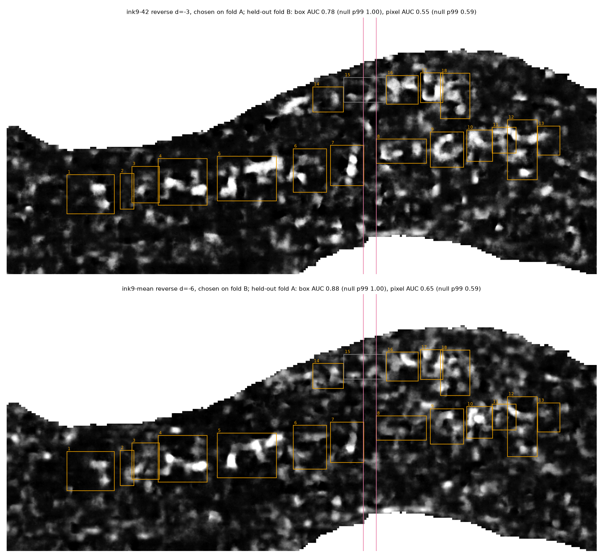

# PHerc. 343 positive control, v2: depth sweep and normal direction

## Question

Does my own pipeline (the `inkcheck` renderer streaming the public scan, then `inkcheck.ink.predict`
with the public `ink_9um` checkpoints) find the published PHerc. 343 letters on a part of the area
whose labels played no part in choosing the model, the normal direction or the depth? And which
normal direction is physically right for this sheet?

An earlier version (v1, not in this repository) scored every pixel of a letter box against every
other pixel, picked direction and depth on the same pixels it scored, and got AUC 0.62 in the
"reverse" direction only. v2 replaces that metric with a held-out one and settles the direction
with a geometry test that does not use any model.

## Setup

- Scan: PHerc0343, volume `20250521140437-8.640um-1.2m-116keV-masked`, 8.64 µm, 116 keV, level 0,
  streamed from the open-data bucket (`inkcheck.volume`).
- Surface: `concat_w047-w048_R5B2_z9500-11000.tifxyz` from Erwin Nieuwlaar's
  [pherc343-first-letters](https://github.com/Nieuwlaar/pherc343-first-letters), normals turned
  away from his scroll axis (`orient_outward`).
- Area: his submission area, raw render rows 105–2560, cols 380–6021 (2455 × 5641 px, 10.3 cm²
  bounding box).
- Render: 66 layers; layer k samples the CT at (k − 32.5) voxels along the outward normal,
  d = k − 33 (same layer convention as his VC3D render). Trilinear sampling.
- Models: `scrollprize/ink_9um` hybrid_3d2d seeds 42 and 43, step 75 000, and their mean. 17-layer
  window centred on layer 33 + d, patch 128, stride 64, Hann blending, villa's per-patch
  normalisation. CPU, 12 threads.
- Sweep: d = −15..+15, both directions, both seeds: 124 maps (+ 62 seed means).

## Labels and split

- Positives: Nieuwlaar's 18 letter boxes (`inputs/..._letter_boxes.json`, raw frame).
- Two folds along the reading direction, fixed from the label file before any map existed:
  - fold A: cols 380–2486, letters 8–13, 16–18 (9 letters);
  - a guard band, cols 2486–2610 (about one model patch), used by neither fold;
  - fold B: cols 2610–6021, letters 1–7 and 14 (8 letters);
  - letter 15 crosses the guard band and is dropped.
- Negatives ("blank"): valid pixels at least 100 px from every letter box, in the same fold. The
  area holds more text than the 18 labelled letters, so some "blank" pixels are ink; that makes the
  scores conservative.
- Scores are computed on 4 × 4 mean-pooled maps.

## Metrics

- **Box AUC**: each letter box scores the 95th percentile of the map inside it, against blank
  boxes of the median letter size on a grid in the same fold (≥ 80 % valid).
- **Pixel AUC**: in-box valid pixels against blank pixels of the same fold.
- **Held-out protocol**: pick the configuration (model × direction × depth) with the best box AUC
  on one fold, then report its scores on the other fold. Both ways round.
- **Null**: each letter box of the held-out fold is moved to a random spot in the same fold
  (≥ 50 % valid, not overlapping a real letter box), and everything is rescored. 1000 draws.
  A plain shuffle of the box labels is reported as well.

I fixed the pass thresholds before computing any map: on both folds, held-out box AUC ≥ 0.80 and
pixel AUC ≥ 0.60, both above the 99th percentile of the null.

### Change to the null, before scoring

The first null I wrote down was a rigid shift of all the fold's boxes. A synthetic check (planted
ink in every letter box, smooth noise elsewhere) showed that the shifted boxes land on the real
letters so often that the null's 99th percentile reached box AUC 1.0 even against perfect planted
ink, so no map could ever pass. I replaced it with the independent random placement above before
scoring any real map. With it, planted ink gives held-out box AUC 1.00 on both folds (null p99 0.72
on fold B, 0.94 on fold A) and noise alone gives 0.39 / 0.59. The thresholds did not change.

### Normal direction

A rendered image reads unmirrored only when seen from the written face. For a raw render with rows r
and columns c, the viewer sits on the e_r × e_c side (assuming the volume axes are right-handed,
i.e. the reconstruction is not mirrored). Nieuwlaar's reading image is the raw render rotated by
180°, not mirrored, so the written face is on the e_r × e_c side. `run.py` measures at how many mesh
nodes that side points toward the scroll axis. If nearly all do, the text faces the axis, and with
outward normals the model window has to be fed in **reverse** layer order. The prediction, made
before the run, was reverse; the check is that the sweep picks reverse on both folds.

## Run

```bash
export CUDA_VISIBLE_DEVICES=-1 INKCHECK_DEVICE=cpu INKCHECK_CPU_THREADS=12
cd experiments/2026-10-12-pherc343-positive-control-v2
../../external/villa/vesuvius/.venv/bin/python run.py          # render + 124 maps + scoring
```

Needs `bash setup.sh` first (villa venv, ink_9um checkpoints in `data/models/ink_9um`). The large
intermediate arrays (`layers.npy`, `probs.npy`) are not in git and are reused if present. Render
1029 s, 124 maps at a median 112 s each, scoring 33 s: about 4.2 h on 12 CPU threads.

## Result

Run 2026-10-12. The signal is there and points the right way, but neither fold clears the bar.

| Held-out fold | Chosen on the other fold | Box AUC (null p50 / p99, p) | Pixel AUC (null p50 / p99, p) | Box AUC, label shuffle (p99, p) |
|---|---|---|---|---|
| B (8 letters, 12 blank boxes) | ink9-42 reverse d = −3 | 0.78 (0.44 / 1.00, 0.093) | 0.55 (0.51 / 0.59, 0.13) | 0.83, 0.023 |
| A (9 letters, 10 blank boxes) | ink9-mean reverse d = −6 | 0.88 (0.52 / 1.00, 0.072) | 0.65 (0.49 / 0.59, 0.001) | 0.80, 0.002 |

The best forward configuration, chosen the same way, gets held-out box AUC 0.50 (B) and 0.28 (A).
The v1 metric on the v1 region gives 0.60 / 0.58 here, against 0.62 in v1.



`fig_heldout_reading.png`: the two held-out maps in reading orientation, letter boxes in orange.
`fig_depth_sweep.png`: box and pixel AUC against depth for every model and direction.
`fig_profile.png`: mean CT and raw letter-vs-blank contrast against depth.

- **Normal direction: settled.** At 99.73 % of 26 749 mesh nodes the written face points toward the
  scroll axis, which predicts reverse, and reverse is chosen on both folds. So v1's "reverse only"
  was right, not a bug.
- **Depth: bracketed, not pinned.** Mean CT peaks at d ≈ +2.5 (the sheet); the next sheet inward is
  at d ≈ −13, with the gap at d ≈ −5. Reverse ink9-mean box AUC peaks at d = −3..−2 on fold A (0.99)
  and at d = −7..−5 on fold B (0.92–0.93), with a flat plateau of 0.83–0.93 from d = −8 to +1 on
  fold B. The two folds disagree by about 4 voxels on the best window centre.
- **Why the bar is not met.** First, the null is saturated by the area itself: at least 1 % of
  random placements of the letter boxes reach box AUC 1.0, because the map has letter-sized bright
  blobs all over the area. Some are unlabelled text, some may be false positives; with 10–12 blank
  boxes per fold, 18 labelled letters cannot tell them apart. Second, fold B separates poorly per
  pixel: its pixel AUC never exceeds 0.56 for any configuration, against 0.72 on fold A. Fold B holds
  the faint letters 1, 2 and 6.
- **Not the cause:** sign convention, depth offset, or a scan or resolution mismatch (same volume
  and mesh as the reference). Normalisation is villa's per-patch scheme, as in the reference.

## Limits

- The renderer was not checked byte for byte against Nieuwlaar's VC3D render. His sidecar records a
  valid fraction of 0.6418 with the rule "all 66 layers > 0"; mine is 0.647 with a different rule.
- The reference reads with four models (dense_native, hecate, ink9-42, ink9-43) at d = +1; v2 uses
  two of them. v3 (`../2026-10-12-pherc343-positive-control-v3/`) adds the other two and fixes the
  negatives.
- A full re-run from a clean checkout (about 4.2 h) was not repeated. Rescoring from the cached maps
  (`python run.py --stage score`) gives the same numbers in `results.json`.
