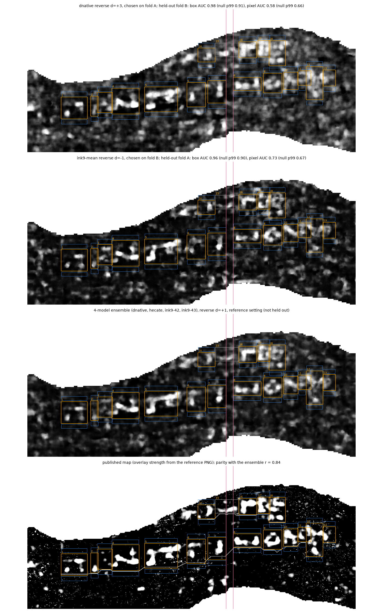

# PHerc. 343 positive control, v3: between-line negatives, four models, and a parity check

## Question

Can my pipeline find the published PHerc. 343 letters on held-out data, and does it reproduce the
published ink map? v3 builds on v2 (`../2026-10-12-pherc343-positive-control-v2/`) and changes two
things:

- **Negatives.** In v2 the area held far more text than the 18 labelled letters, so random box
  placements hit text and the null reached box AUC 1.0. v3 takes negatives from the bands between
  the text lines, derived from the letter boxes alone.
- **Models.** v3 adds the two other models of the reference ensemble (dense_native and hecate),
  so the full four-model map can be compared with the published one.

I wrote this design after seeing the v2 numbers, so it is not blind to v2. The thresholds are the v2
ones, unchanged, and I fixed everything below before computing any v3 number.

I did not use the reference's row annotations for the negatives: in the reference code those row
lines are routed around "visible ink" in the ensemble image, which shares two of its four models
with mine (`make_submission_image.py`, ROW LINES). Negatives chosen that way would be low-ink by
construction.

## Setup

- Scan: PHerc0343, `20250521140437-8.640um-1.2m-116keV-masked`, 8.64 µm, 116 keV, level 0 (streamed).
- Surface, area and render: as v2 (66 layers, layer k at (k − 32.5) voxels along the outward
  normal, d = k − 33, raw rows 105–2560, cols 380–6021). v3 reuses v2's `layers.npy`; v2's `run.py`
  rebuilds it if it is missing.
- Direction: reverse only (outward normals, model window fed in reverse layer order). v2 settled
  this.
- Models (all public, sha256-checked by the reference's `fetch_checkpoints.sh`):
  - ink9-42, ink9-43: `scrollprize/ink_9um` hybrid_3d2d step 75 000 (maps reused from v2);
  - dnative: `Nieuwlaar/ink9um-dense-native` step 16 000, rebuilt `.pth` (the reference's
    documented fallback; the exact training file is not public);
  - hecate: `scrollprize/hecate` 9.6 µm, run through its own `hecate.py`, input prepared as in
    `hecate_prep.py`, output resized to the render grid.
- Sweep: ink9-42, ink9-43 and dnative at d = −15..+15. **hecate at d = +1 only** (the reference's
  setting): one hecate map takes about 75 min on CPU, so a full sweep would take about 39 h.
- Ensembles, as in the reference's `ensemble_maps.py`: per model a z-score over all its maps, then
  the mean. `ens3` = dnative + ink9-42 + ink9-43 (all depths); `ens4` = all four (d = +1 only).
  One difference: hecate's z-score statistics come from d = +1 only.
- CPU, 12 threads.

## Labels and split

- Positives and folds as in v2: fold A cols 380–2486 (letters 8–13, 16–18), guard band 2486–2610,
  fold B cols 2610–6021 (letters 1–7, 14); letter 15 crosses the guard band and is dropped.
- **Negatives: between-line bands.** For each letter box, one band of the same width just below it
  and one just above it, 16 px away from the box and 78 px deep. 78 px is the narrowest gap between
  two overlapping lines of letters (110 px, boxes 10 and 18) minus twice the 16 px clearance, so a
  band fits into every labelled gap. Band pixels closer than 16 px to any letter box are removed; a
  band counts if it lies inside one fold and is at least 50 % valid. Unlabelled lines above or below
  can still reach into a band, which makes the test conservative.
- Scores on 4 × 4 mean-pooled maps (as v2).

## Metrics

- **Box AUC**: 95th percentile of the map inside each box, letter boxes against bands of the same
  fold.
- **Pixel AUC**: letter-box pixels against band pixels of the same fold.
- **Held-out protocol** (as v2): choose the configuration (ink9-42, ink9-43, ink9-mean, dnative or
  ens3, at any depth) with the best box AUC on one fold, score it on the other fold. Both ways round.
- **Null (surrogate maps)**: keep the labels, replace the held-out part of the map by a surrogate
  with the same power spectrum and the same value distribution (random Fourier phases, then the
  original values re-assigned by rank). 1000 draws. This keeps the blob size and contrast of the
  map but breaks any alignment between blobs and letters, and it does not depend on where the
  unlabelled text is.
- **Parity**: my ens4 at d = +1, put through the published overlay transform, against the overlay
  strength read back from the published PNG (`(R − B) / 135`; the area is located in the PNG by
  matching my CT layer 34 to the PNG's grey, never by the ink).

I fixed the thresholds before running the evaluation: on both folds, held-out box AUC ≥ 0.80 and
pixel AUC ≥ 0.60, both above the null's 99th percentile; parity Pearson r ≥ 0.80.

### Synthetic check (before any real score)

| Planted signal | Fold A box AUC (null p99) | Fold A pixel AUC (null p99) | Fold B box AUC (null p99) | Fold B pixel AUC (null p99) |
|---|---|---|---|---|
| Rings covering ~22 % of each box (the planned check) | 1.00 (0.88) | 0.58 (0.60) | 1.00 (0.87) | 0.63 (0.61) |
| Whole box (added after the ring result) | 1.00 (0.91) | 0.98 (0.69) | 1.00 (0.90) | 0.98 (0.72) |
| Noise only | 0.53 (0.85) | 0.44 (0.59) | 0.49 (0.84) | 0.50 (0.58) |

The ring plant misses the pixel threshold on fold A, and that is the metric, not a code bug: pixel
AUC counts every pixel of a letter box as positive, and most of a box is bare papyrus. With perfect
ink on 22 % of the box, the expected pixel AUC is about 0.5 + 0.22 / 2 ≈ 0.61, right at 0.60. So the
pixel threshold can only be met by maps whose ink covers well over a fifth of each letter box.
Smooth, blobby model maps can do that; thin, sharp strokes cannot. I left the threshold as it was.
The box metric and the null behave as intended, and the whole-box plant checks the code end to end.

## Run

```bash
export CUDA_VISIBLE_DEVICES=-1 INKCHECK_DEVICE=cpu INKCHECK_CPU_THREADS=12
PY=external/villa/vesuvius/.venv/bin/python
PY=$PY bash external/pherc343-first-letters/ink/scripts/fetch_checkpoints.sh \
    external/pherc343-first-letters/ink/models.tsv data/models/pherc343_ref
cd experiments/2026-10-12-pherc343-positive-control-v3
../../external/villa/vesuvius/.venv/bin/python run.py     # v2 render/maps if needed, dnative + hecate, scoring
```

The short way, `bash tools/inkcheck/quickstart.sh` from the repository root, goes from a fresh clone
to the two held-out numbers without the sweep: `quickstart.py` renders the area, computes only the
three maps the two held-out configurations need, scores them with this `run.py`'s code and seed, and
checks every number against `results.json` (exit 1 on any difference). See
`tools/inkcheck/README.md` for times and memory.

`python run.py --stage score` rescores from cached maps (13 min). `python diag_overlay.py` (7 min)
runs the display-transform diagnostic below.

## Result

Scored 2026-10-13. Scan PHerc0343 `20250521140437`, 8.64 µm, 116 keV, level 0, reverse direction
(outward normals). ink9 and dnative d = −15..+15, hecate d = +1. Null = 1000 surrogate maps.

| Map (how chosen) | Fold | Box AUC (null p50 / p99, p) | Pixel AUC (null p50 / p99, p) | Meets the thresholds |
|---|---|---|---|---|
| dnative d = +3 (chosen on A) | **B, held out** | 0.98 (0.64 / 0.91, 0.002) | 0.58 (0.50 / 0.66, 0.16) | no |
| ink9-mean d = −1 (chosen on B) | **A, held out** | 0.96 (0.61 / 0.90, 0.003) | 0.73 (0.50 / 0.67, 0.001) | yes |
| ens4 d = +1 (reference setting, not held out) | A | 0.99 (0.62 / 0.91, 0.001) | 0.79 (0.50 / 0.70, 0.001) | yes |
| ens4 d = +1 (reference setting, not held out) | B | 0.99 (0.63 / 0.94, 0.002) | 0.64 (0.50 / 0.70, 0.048) | no |
| hecate d = +1 (not held out, not in the selection set) | A | 1.00 (0.62 / 0.91, 0.001) | 0.80 (0.50 / 0.68, 0.001) | yes |
| hecate d = +1 (not held out, not in the selection set) | B | 0.98 (0.61 / 0.92, 0.003) | 0.71 (0.50 / 0.70, 0.005) | yes |
| published map | A | 1.00 (0.60 / 0.93, 0.001) | 0.77 (0.50 / 0.61, 0.001) | yes |
| published map | B | 0.99 (0.62 / 0.95, 0.001) | 0.65 (0.50 / 0.58, 0.001) | yes |

For the held-out maps, a shuffle of the box labels gives p99 0.79 (B) / 0.78 (A), both p = 0.001;
v2's random-box null gives p99 0.98 / 0.95 for box AUC, p = 0.015 on both folds.



`fig_reading.png`, top to bottom: the two held-out maps, my ens4 at the reference setting, and the
published map, in reading orientation. Orange: letter boxes. Blue: between-line bands.

In short:

- **At box level the control works on held-out data.** Held-out box AUC is 0.98 (fold B) and 0.96
  (fold A), above a null p99 of 0.91 and 0.90.
- **At pixel level it fails on one fold.** Fold B's held-out pixel AUC is 0.58, under 0.60 and under
  the null p99 of 0.66. No ink9 or dnative configuration gets fold B pixel AUC above 0.66 at any
  depth. hecate alone at d = +1 reaches 0.71, but it was not in the selection set, so it does not
  count as a held-out result.
- **My code reproduces the published map.** Parity Pearson r = 0.84 over 8.78 M valid pixels
  (4 × 4 pooled 0.84, Spearman 0.72); the CT match used to place the area in the PNG has r = 0.96.
  This checks the reproduction (same checkpoints, same render geometry, same transform), not ink.
- **Letters are readable in some boxes only.** That is my own read of `fig_reading.png`; the two
  held-out maps look like the published map, only blurrier.
- **Depth.** Box AUC stays at 0.80 or more for d ≈ −7..+5 on both folds and drops to chance by
  d = −12.
- **Ruled out:** sign convention (v2), depth offset (31-depth sweep), scan or resolution mismatch
  (one volume, CT match r = 0.96), label registration (box AUC ≈ 1.0 on both folds), negatives that
  are hidden text (the surrogate null does not depend on unlabelled text).
- **Not tested:** the exact dense_native training file (not public); a hecate depth sweep (about
  39 h on CPU); labels for the rest of the text in the area.

### Why the published map passes and mine does not (diagnostic)

I wrote this after the scores; it does not change the result above. The published map is the same
four-model ensemble after the published display transform, which sets 85 % of pixels to zero.
`diag_overlay.py` puts my ens4 d = +1 through that same transform and scores it with the unchanged
test (`diag_overlay.json`).

| ens4 d = +1, fold B | Box AUC (null p99) | Pixel AUC (null p50 / p99, p) | Meets the thresholds |
|---|---|---|---|
| raw z-score (as in the table above) | 0.99 (0.95) | 0.643 (0.50 / 0.69, 0.061) | no |
| same map, published display transform | 0.99 (0.92) | 0.628 (0.50 / 0.56, 0.001) | yes |
| published map | 0.99 (0.95) | 0.652 (0.50 / 0.58, 0.001) | yes |

Fold A passes in all three rows. The pixel AUC itself barely moves (0.643 → 0.628, published 0.652).
What moves is the null: a map that is mostly exactly zero gives a much narrower surrogate
distribution (p99 0.69 → 0.56). So the gap comes from the display transform, not from signal my
pipeline loses; the parity check (r = 0.84) says the same.

It also shows a weakness of this test: the surrogate null on pixel AUC is not invariant to monotone
transforms with ties, so thresholding a map can turn a fail into a pass. A future version has to fix
the map transform before it is scored.

## Limits

- **The letter boxes are not independent of the models.** The reference author drew them by hand on
  the published ink map, which is the mean of the same four models I run. The box AUC measures
  agreement between my maps and those boxes, not independent proof that the boxes hold ink. The
  fold split controls the choice of model and depth; it does not remove this.
- **Box level only.** Pixel-level claims would need a new threshold, with the map transform fixed in
  advance.
- **Selection is tuned on this area.** The held-out protocol picks the best of 5 models × 31 depths
  on one fold. hecate ran at one depth only.
- A full clean re-run (render 17 min, about 1 h dnative, about 1.8 h hecate on CPU) was not repeated;
  the quickstart reproduces the two held-out numbers from a fresh clone.
